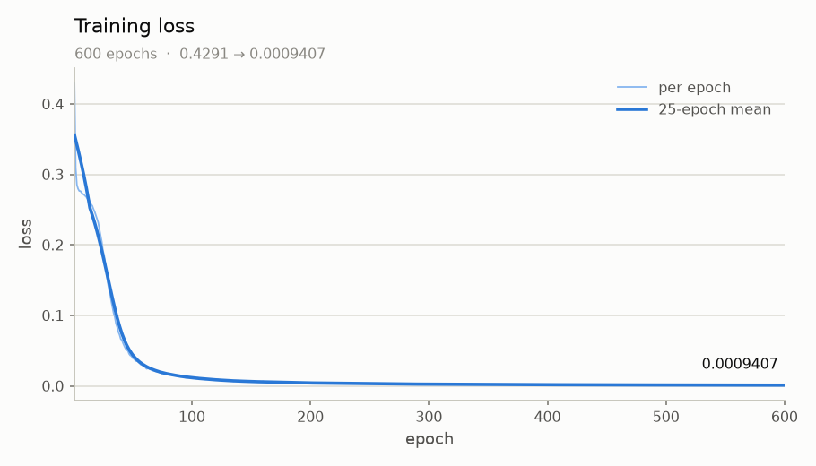
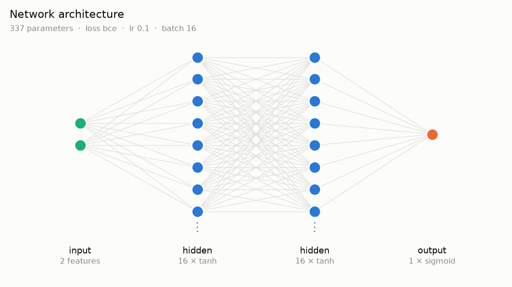
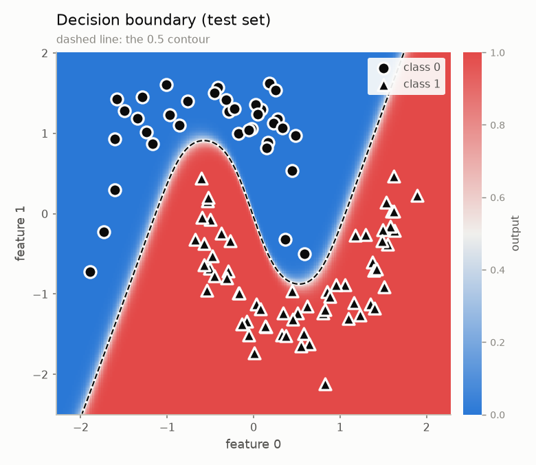
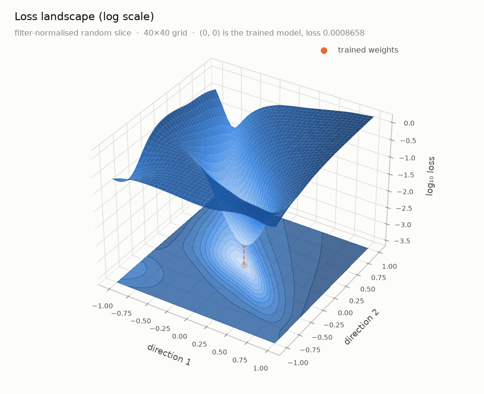
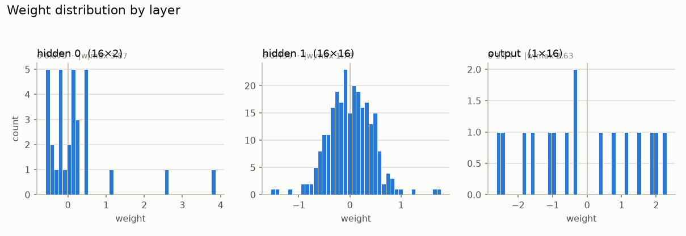
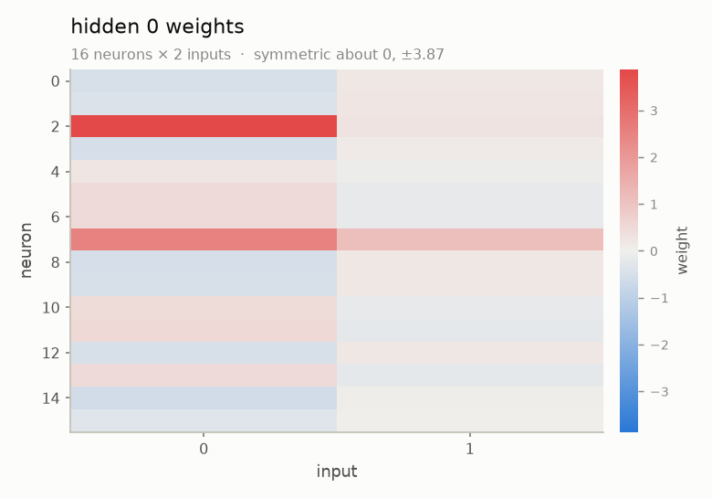
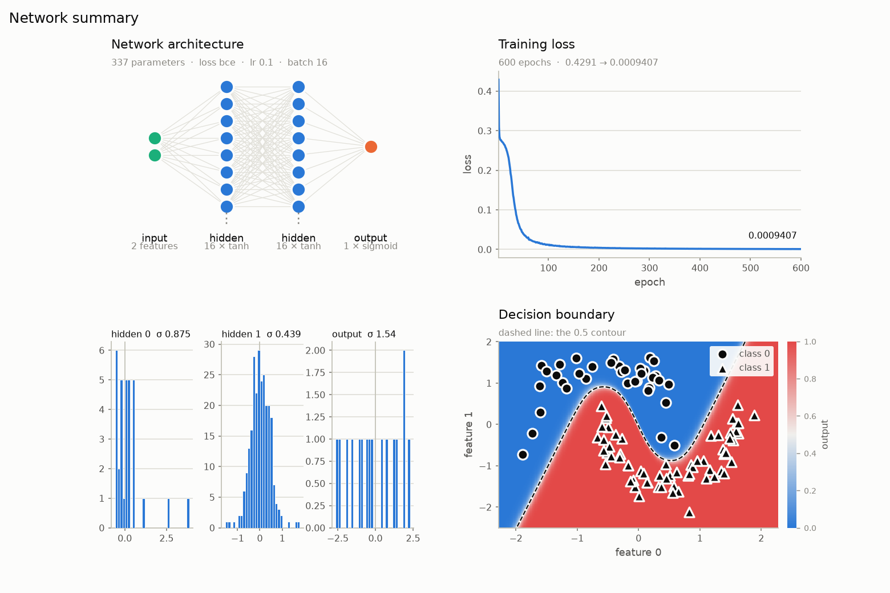

<div align="center">
   <pre>
 ██████  ██████   █████  ██████  ██ ███████ ██   ██ 
██       ██   ██ ██   ██ ██   ██ ██ ██       ██ ██  
██   ███ ██████  ███████ ██   ██ ██ █████     ███   
██    ██ ██   ██ ██   ██ ██   ██ ██ ██       ██ ██  
 ██████  ██   ██ ██   ██ ██████  ██ ███████ ██   ██ 
   </pre>
</div>

<div align="center">

**A feedforward neural network engine in C++20 — no BLAS, no Eigen, no dependencies.**

[](https://github.com/snehashish090/GradieX/blob/main/LICENSE)
[](https://en.cppreference.com/w/cpp/20)
[](https://www.python.org/)
[](https://github.com/snehashish090/GradieX/blob/main/CHANGELOG.md)

</div>


**v0.0.4 is the templated line.** The architecture is v0.0.2's — a network of
layers, each holding its weights in one flat contiguous buffer — and v0.0.3's
single-precision hot loops, but every scalar type is now a template parameter:
activations, losses and initializers are function templates on `T`,
`Layer<T>`/`HiddenLayer<T>`/`OutputLayer<T>` compute entirely in `T`, and
`Network<IO>` (default `float`) is the type-erased container that stitches them
together.

**Each layer picks its own data type.** A layer's constructor takes a `DType`
(`float32` / `float64`) next to its function pointers, and the network validates
that the two agree. Adjacent layers may differ — a `float64` hidden layer can sit
inside a `float32` network — and the engine converts at every boundary. The
network's IO stays `float32` by default (switch it per network with
`Network(dtype="float64")`), so the Python contract is unchanged; layers move
precision independently.

Training lives in the engine. The Python `train()` is one call into
`core::Network::train`: the epoch loop, the shuffle, the batching, gradient
accumulation and the update rule are all C++, with the GIL released. A 4000-epoch XOR
run through Python is bit-identical to the same run from `main.cpp`.

New in v0.0.4: a templated engine with per-layer data types. Carried over from
v0.0.3: per-epoch shuffling, seeded weight initialisation, a derivative lookup
that ties each activation and loss to its own derivative, and a
[matplotlib plotting layer](#plots) — loss curves, architecture diagrams, decision
boundaries, weight maps and 3-D loss landscapes.

```python
import numpy as np, gradiex

X = np.array([[0., 0.], [0., 1.], [1., 0.], [1., 1.]])
Y = np.array([[0.], [1.], [1.], [0.]])

gradiex.seed(42)                       # reproducible weight initialisation
net = gradiex.Network(learning_rate=0.5, batch_size=4)
net.add_hidden(8, input_size=2, activation="tanh", init="xavier")
net.add_output(1, activation="sigmoid", loss="mse")
net.build()

history = net.train(X, Y, epochs=4000, shuffle=True, seed=42, plot=True)
print(history[0], "->", history[-1])        # 0.29662 -> 0.00024
print(net.predict([1., 0.]))                # [0.9838] (float32)
```

*Written by Snehashish Laskar. MIT licensed.*


## Contents

- [What's new in v0.0.4](#whats-new-in-v004)
- [What's new in v0.0.3](#whats-new-in-v003)
- [Memory Architecture](#memory-architecture)
- [Install](#install)
- [Quick Start](#quick-start)
- [Plots](#plots)
- [API](#api)
- [Names: Activations, Losses, Initializers](#names-activations-losses-initializers)
- [What the Python Layer Guarantees](#what-the-python-layer-guarantees)
- [Notation](#notation)
- [Activations and Losses](#activations-and-losses)
- [Data Flow](#data-flow)
- [Training](#training)
- [Using the C++ Engine Directly](#using-the-cpp-engine-directly)
- [Tests](#tests)
- [Feature Parity with v0.0.1](#feature-parity-with-v001)
- [Invariants](#invariants)
- [Not Supported](#not-supported)
- [Roadmap](#roadmap)
- [Contributing](#contributing)
- [License](#license)

---

## What's new in v0.0.4

| | v0.0.3 | v0.0.4 |
|---|---|---|
| Scalars | `float` everywhere | **templated** — `Layer<T>`, `Network<IO = float>` |
| Activations / losses / initializers | `float*` function pointers | **`template <typename T>` functions** — one kernel per scalar type |
| Layer data type | uniform across the network | **per layer**, via a `DType` constructor argument |
| Mixed precision | impossible | **any mix of `float32`/`float64` layers**, converted at each boundary |
| Mismatched dtype + functions | not expressible | **rejected at construction** with `std::invalid_argument` |
| Derivative validation | Python binding only | **also in `Network::addHiddenLayer` / `addOutputLayer`** |
| Network copying | implicitly possible — double-frees | **deleted** |
| Python API | `add_hidden(width, ..., activation, init)` | `Network(dtype=...)` picks the IO dtype; `add_hidden/add_output(..., dtype=...)` per layer; `gradiex.dtypes()`, `net.dtype`, `dtype` in `net.layers` |

The templating is a pure refactor on the float32 path: a network whose layers all
declare `DType::float32` runs the same hot loops v0.0.3 ran, with the same
zero-allocation forward/backward passes. The only new work appears where you ask for
it — a layer that disagrees with its neighbour converts at the boundary.

```python
# a float64 hidden layer inside a float32 network
net.add_hidden(16, input_size=2, activation="tanh", init="xavier", dtype="float64")
```

```cpp
// the same, in C++: the DType argument must agree with the function pointers' type
net.addHiddenLayer(0, 16, 2, core::DType::float64,
                   core::functions::activations::tanh<double>,
                   core::functions::initializers::xavier<double>,
                   core::functions::loss::mse<double>);
```

---

## What's new in v0.0.3

| | v0.0.2 | v0.0.3 |
|---|---|---|
| Scalar type | `double` | **`float` throughout** |
| Vectorisation | hand-unrolled, four accumulators | **`#pragma omp simd`**, with `reduction` on the dot product |
| Gradients | assigned, applied per sample | **accumulated, scaled by `1/batchSize`, applied once** |
| Training | per-sample SGD | **mini-batch SGD** — `Network(..., int batches)` |
| Shuffling | none | **per-epoch, seeded**, inside `train()` |
| Seeded init | none | **`initializers::setSeed`** / `gradiex.seed` |
| Derivatives | passed in by the caller, unchecked | **looked up from the forward function** |
| Layer constructor | 7 arguments | **5** — both derivatives are derived |
| `computeLoss` | always squared error | **calls the configured loss** |
| Python bindings | `double`, per-sample loop in the binding | **`float`, training delegated to the engine** |
| Plotting | none | **seven matplotlib diagrams, light and dark** |
| Tests | several fail by design | **91 checks, all passing** under ASan and UBSan |

Eight of the twelve defects the v0.0.3 reference page listed are now closed, including
one that mattered in practice: the log-based losses guarded their probabilities with
`1e-12`, a double-precision constant that rounds away entirely in `float32`. Since
`1.0f - 1e-12f` *is* `1.0f`, the upper clamp never bit, and a saturated sigmoid gave
`log(0)` and a division by zero — `inf * 0` is `NaN`, which reaches every weight on
the next update and never washes out. A two-moons run diverged at epoch 243 with the
loss already down at 0.003. The guard is `1e-7f` now, and five regression tests pin it.

## Memory Architecture

Three ideas, in order of how much they matter.

### 1. Flattened layout, per layer

Every layer owns its buffers, and each buffer is one flat, contiguous vector in the
layer's scalar type `T`. A layer of width $n$ fed by `inputSize` inputs stores its
weight matrix as a flat `n × inputSize` array (`neuronWeights`), neuron $i$'s row at
`i * inputSize`:

```cpp
// layer l, neuron i, input j
neuronWeights[i * inputSize + j]      // w^{(l)}_{ij}
```

Biases, pre-activations, activations, deltas, weight gradients and bias gradients
are each one flat per-layer vector, all sized once in the constructor. There is no
`vector<vector<T>>` anywhere: a nested vector means one heap allocation per neuron
and a cache-hostile strided walk.

The same trick covers the working buffers. `layerInputs`, `scratchPad1`,
`scratchPad2` and — for mixed-dtype layers — the boundary-conversion scratch
(`nextDeltaScratch_`, `nextWeightScratch_`, `targetScratch_`) are each one flat
per-layer vector whose size is fixed by the layer geometry.

### 2. Zero heap allocations on the hot path

Everything a forward or backward pass needs is sized at construction time and never
reallocated:

| Buffer | Size | Purpose |
|---|---|---|
| `neuronWeights` | $n \cdot m$ | weight matrix, one row per neuron |
| `neuronBiases` | $n$ | bias per neuron |
| `layerInputs` | $m$ | the input from the last forward pass, in this layer's dtype |
| `neuronOutputsUnactivated` / `neuronOutputsActivated` | $n$ | $z$ and $a$, per neuron |
| `neuronDeltas` | $n$ | local gradients $\delta$ |
| `neuronWeightGradients` / `neuronBiasGradients` | $n \cdot m$ / $n$ | accumulated gradients |
| `scratchPad1` / `scratchPad2` | $n$ | derivative outputs during `computeErrorSignal` |
| conversion scratch | varies | foreign-dtype activations/deltas/weights/targets, resized once |

`calculateOutputs`, `computeGradients` and the SGD step touch only these. Mixed-
dtype layers pay one conversion pass over the crossing buffers per boundary — the
conversion scratch is allocated on the first use and reused from then on, so the
steady-state hot path stays allocation-free.

### 3. SIMD pragmas

v0.0.2 unrolled the inner dot product by hand into four accumulators. The engine now
asks the compiler instead:

```cpp
for (int neuron = 0; neuron < width; ++neuron)
{
    const T* __restrict w = neuronWeights + neuron * inputSize;
    T sum = static_cast<T>(0);
    #pragma omp simd reduction(+:sum)
    for (int inputIdx = 0; inputIdx < inputSize; ++inputIdx)
        sum += w[inputIdx] * layerInputs[inputIdx];
    neuronOutputsUnactivated[neuron] = sum + neuronBiases[neuron];
}
```

The same directive covers zeroing, scaling and applying gradients, the boundary
conversions, and every activation and loss. `__restrict` pointers are established
before each loop so the compiler knows the buffers do not alias.

> **This only does something if OpenMP is enabled.** Built without
> `-fopenmp-simd`, `#pragma omp simd` is accepted and discarded in silence — no
> error, no warning, not even under `-Wall -Wextra`. Apple clang rejects
> `-fopenmp` (the flag the docs usually name) but accepts **`-fopenmp-simd`**,
> which enables exactly the SIMD directives and needs no runtime library — and
> `core/` uses nothing else, no parallel regions. That is the flag to reach for on
> macOS; `./tests/run_tests.sh --simd` exercises it.

## Install

```bash
pip install gradiex
```

Wheels are published for CPython 3.9–3.14 on Linux (x86_64 and aarch64,
manylinux and musllinux), macOS (Intel and Apple silicon) and Windows. Anywhere
without a wheel, pip falls back to the sdist and compiles the engine for you —
that requires a C++20 compiler and Python 3.9+.

`numpy` and `matplotlib` are installed as dependencies.

### From source

Inside a checkout of this release directory:

```bash
pip install .            # or: pip install -e .   for development
```

`core/` is header-only and compiled directly into the extension module. To build in
place, which is what the tests and examples expect:

```bash
python3 setup.py build_ext --inplace
```

For the C++ engine alone, nothing is needed but a compiler:

```bash
clang++ -std=c++20 -O2 -fopenmp-simd main.cpp -o main
./main
```

`-fopenmp-simd` is what makes the `#pragma omp simd` directives in `core/` apply. It
is worth up to **2.4×** on wide layers — see [Benchmarks](#benchmarks). Apple clang
rejects `-fopenmp` but accepts this, and `core/` needs nothing more: it uses SIMD
directives only, no parallel regions, so no runtime library is involved. Without the
flag the pragmas are accepted and discarded in silence.

> `setup.py` lists `core/*.h` in `depends`. Without it, setuptools time-stamps only
> the `.cpp`, so editing a header leaves a stale `.so` in place and the next run
> silently tests the previous engine.

## Quick Start

```python
import numpy as np, gradiex

X = np.array([[0., 0.], [0., 1.], [1., 0.], [1., 1.]])
Y = np.array([[0.], [1.], [1.], [0.]])

gradiex.seed(42)
net = gradiex.Network(learning_rate=0.5, batch_size=4)   # 0 = one batch per epoch
net.add_hidden(8, input_size=2, activation="tanh", init="xavier")
net.add_output(1, activation="sigmoid", loss="mse")
net.build()

history = net.train(X, Y, epochs=4000, shuffle=True, seed=42)
print(net.predict([1., 0.]))                # [0.9838]
```

```cpp
#include "core/network.h"
namespace act = core::functions::activations;
namespace ini = core::functions::initializers;
namespace los = core::functions::loss;

ini::setSeed(42);
core::Network net(1, 1, 0.5f, 4);           // 1 hidden, 1 output, lr, batch size
net.addHiddenLayer(0, 8, 2, act::tanh<float>,    ini::xavier<float>, los::mse<float>);
net.addOutputLayer(0, 1, 8, act::sigmoid<float>, ini::xavier<float>, los::mse<float>);
net.initializeAllWeightsAndBiases();

std::vector<float> history(4000);
net.train(X, Y, 4000, history.data(), (int)history.size(),
          /*verbose=*/false, /*shuffle=*/true, /*seed=*/42u);
```

Both reach `0.296616971 -> 0.000236376116`. The derivatives are not passed in: the
layer resolves each from its forward function, so a mismatched pair is unreachable.

## Plots

`examples/two_moons.py` trains a `2 → 16 → 16 → 1` network on two interleaving
moons — a curved boundary, so the hidden layers have to do real work — and writes
every diagram below. It reaches 100 % train and test accuracy.

```bash
python3 examples/two_moons.py
```

`train(..., plot=True)` draws the loss curve when training finishes and leaves the
figure on `net.last_figure`. Every plot takes an optional `ax=` and returns its
figure, so they compose; nothing calls `show()` unless you pass `show=True`. Each
accepts `theme="light"` or `theme="dark"`.

| | |
|---|---|
|  |  |
| **`plot_loss(smooth=25)`** — the raw trace recedes and the moving average carries the line. The final value is labelled directly. | **`plot_architecture()`** — layers wider than `max_nodes` are drawn truncated, but the label always states the true width. |
|  |  |
| **`plot_decision_boundary(X, Y)`** — sample markers sit in ink rather than the series hues, since over a diverging field a blue marker would land on its own colour and vanish. | **`plot_loss_landscape(X, Y, log=True)`** — the basin the optimiser settled in, on two filter-normalised random directions. |
|  |  |
| **`plot_weight_distribution()`** — one histogram per layer. A layer collapsed at zero is dead; one spread far wider than its neighbours is about to diverge. | **`plot_weight_heatmap(0)`** — weights are signed, so the ramp is diverging and symmetric about zero. A sequential ramp would hide the sign. |



**`plot_summary(X, Y)`** — architecture, loss, weights and the data fit in one figure.
Panels with nothing to draw are left out rather than shown empty.

### On the loss landscape

Two random directions are drawn through the trained weights and **filter-normalised**:
each direction row is scaled to the norm of the weight row it perturbs. That is what
makes the picture mean anything — the loss is invariant to rescaling a neuron's
weights, so an unnormalised step moves small-weight neurons a long way in function
space and large-weight ones barely at all, and the result describes the weight scales
rather than the loss. The method is from Li et al., *Visualizing the Loss Landscape of
Neural Nets* (2018).

It is a random 2-D slice of a 337-dimensional surface. Read it as a texture: it shows
whether the basin is broad and smooth or narrow and ragged, **not** the path the
optimiser took or where other minima are. A different `seed=` gives a different slice.
The sweep restores the trained weights exactly when it finishes.

## API

### `gradiex.Network(learning_rate=0.01, batch_size=1, dtype="float32")`

Layers are declared, then the engine is constructed by `build()`. Nothing can be run
until then, and no layers can be added after. `batch_size` is how many samples are
accumulated before one update: `1` is per-sample SGD, `0` means one batch per epoch.

| method | description |
|---|---|
| `add_hidden(width, input_size=None, activation="relu", init="he", dtype="float32")` | Append a hidden layer. `input_size` defaults to the previous layer's width, and is required only on the first layer. `dtype` is the scalar type the layer computes in (`float32` or `float64`). |
| `add_output(width, input_size=None, activation="sigmoid", loss="mse", init="he", dtype="float32")` | Add the output layer. Call once, after all hidden layers. |
| `build()` | Construct the engine, size every buffer, and initialize weights. Alias: `initialize()`. |
| `train(X, Y, epochs=100, shuffle=False, seed=None, verbose=False, log_every=0, plot=False)` | Runs in the engine. Returns mean loss per epoch, and stores it on `.history`. |
| `train_batch(X, Y)` | One engine batch step over these samples. Returns the mean batch loss. |
| `evaluate(X, Y)` | Mean loss over a dataset, engine-side, with no update applied. |
| `forward(x)` / `predict(x)` | One forward pass; returns the output activations. |
| `loss(x, y)` | Forward `x`, then return the configured loss against `y`. |
| `weights(layer)` / `biases(layer)` | Arrays in the network's IO dtype (`float32` or `float64`); weights shaped `(width, input_size)`. Negative indices allowed. |
| `set_weights(layer, values)` / `set_biases(layer, values)` | Overwrite a layer's parameters. Weights accept `(width, input_size)` or flat. |

Gradient primitives, one per engine call, for a hand-rolled loop: `zero_gradients()`,
`accumulate(y)`, `scale_gradients(factor)`, `apply_gradients()`. `backward(y)` is the
convenience form — zero, accumulate, apply — for the sample just forwarded.

Plotting, each also available as a module function taking the network:
`plot_loss`, `plot_architecture`, `plot_weight_distribution`, `plot_weight_heatmap`,
`plot_decision_boundary`, `plot_predictions`, `plot_loss_landscape`, `plot_summary`.

Properties: `learning_rate` and `batch_size` (writable), `layers`, `num_hidden`,
`input_size`, `output_size`, `built`, `history`, `last_figure`.

Module level: `gradiex.seed(n)` seeds weight initialisation, `gradiex.THEMES` holds
the two palettes.

Inputs accept anything NumPy can cast to the network's IO dtype — `float32` by
default, `float64` for `Network(dtype="float64")` — and `net.dtype` reports it.
Predictions, `weights()`/`biases()` and the loss history all come back as arrays
in that dtype. The learning rate is stored as `float32`, so `net.learning_rate`
reads back rounded — setting `0.05` returns `0.05000000074505806`.

Each layer picks its own scalar type with the `dtype` argument of `add_hidden()` /
`add_output()`: `"float32"` (the default) or `"float64"`, independently of the
network's IO dtype. A `float64` hidden layer inside a `float32` network computes
its activations and gradients in double, and the engine converts at the layer
boundaries — float32 in and out, higher precision where you asked for it. The
reverse also works: `Network(dtype="float64")` with all-float32 layers exchanges
float64 arrays with you and converts at the first layer. `net.layers` reports each
layer's `dtype`, and `gradiex.dtypes()` lists the choices.

### Names

```python
gradiex.activations()   # gelu, identity, leaky_relu, linear, relu, sigmoid, softmax, swish, tanh
gradiex.losses()        # mse, mae, huber, bce, binary_cross_entropy, cce, cross_entropy, softmax_cross_entropy
gradiex.initializers()  # zeros, xavier, he
gradiex.dtypes()        # float32, float64
```

Activations and losses are selected by name. The engine resolves each derivative from
the forward function itself, and the binding checks that lookup at `add_*` time — so
an activation the engine cannot differentiate is refused rather than stored as a null
pointer and called on the first backward pass.

`activation="softmax"` is one such case: its derivative is a Jacobian and only the
fused form is implemented. Use `activation="identity"` with
`loss="softmax_cross_entropy"`, which computes `dL/dz = softmax(z) - y` directly.
`predict()` then returns logits rather than probabilities.

## What the Python Layer Guarantees

The C++ API can reach several states that crash or train incorrectly. The binding
collects layer specs first and constructs `core::Network` only in `build()`, so those
states are unreachable — every one of these raises a Python exception instead:

- an out-of-range layer index, or unfilled layer slots at initialization
- an activation the engine cannot differentiate (e.g. `softmax`), or a loss without
  a registered derivative
- a `dtype` argument that is not one of `float32` / `float64`
- more than one output layer — `accumulateGradients` propagates from
  `outputLayers[0]` only, so a second output layer would train silently wrong
- a layer chain whose shapes don't connect
- input or target vectors of the wrong length
- using the network before `build()`, or adding layers after it

The layer also validates names against the tables *for the requested dtype* at
`add_*` time — so a misspelled activation raises on the call that made it, not later
at `build()`. The dtype argument and the function pointers are additionally checked
against each other inside the engine, so the two can never disagree.

## Notation

Layers are indexed by $l$, with $\mathbf{a}^{(0)} = \mathbf{x}$ the input and $L$ the
output layer.

| Symbol | Meaning |
|---|---|
| $\mathbf{x}$ | the input vector |
| $\mathbf{z}^{(l)}$ | pre-activations of layer $l$, before the activation is applied |
| $\mathbf{a}^{(l)}$ | activations of layer $l$, $f^{(l)}\!\left(\mathbf{z}^{(l)}\right)$ — what layer $l+1$ receives |
| $\mathbf{p}$ | the network's predictions, $\mathbf{a}^{(L)}$ |
| $\mathbf{y}$ | the target / ground truth |
| $W^{(l)}, \mathbf{b}^{(l)}$ | weight matrix and bias vector of layer $l$ |
| $\delta_i^{(l)}$ | local gradient, $\partial L / \partial z_i^{(l)}$ |
| $n$ | number of elements in the vector under discussion |
| $\eta$ | learning rate |
| $B$ | batch size (currently always $1$) |

> The file header in `core/` cannot render LaTeX, so it writes vectors in the form
> `:v:` — `:z:`, `:a:`, `:p:`, `:y:` correspond to $\mathbf{z}$, $\mathbf{a}$,
> $\mathbf{p}$, $\mathbf{y}$ here.

## Activations and Losses

### Activation functions

All activations except softmax are elementwise, so each is written as a scalar
function $f(x)$. v0.0.2 adds `gelu` and `swish`; the rest carry over from v0.0.1.

| Name | $f(x)$ | $f'(x)$ |
|---|---|---|
| `sigmoid` | $\sigma(x) = \dfrac{1}{1 + e^{-x}}$ | $\sigma(x)\left(1 - \sigma(x)\right)$ |
| `tanh` | $\dfrac{e^{x} - e^{-x}}{e^{x} + e^{-x}}$ | $1 - \tanh^{2}(x)$ |
| `relu` | $\max(0, x)$ | $1$ if $x > 0$, else $0$ |
| `leaky_relu` | $x$ if $x > 0$, else $\alpha x$ | $1$ if $x > 0$, else $\alpha$ |
| `swish` | $x\,\sigma(x)$ | $\sigma(x) + x\,\sigma(x)\left(1 - \sigma(x)\right)$ |
| `gelu` | $x\,\Phi(x)$ | $\Phi(x) + x\,\phi(x)$ |

with $\alpha = 0.01$ for `leaky_relu`, $\Phi$ the standard normal CDF, and $\phi$ its
density. `gelu` uses the exact form, not the $\tanh$ approximation. Softmax is
layer-wide rather than elementwise:

$$
\mathrm{softmax}(\mathbf{z})_i \;=\; \frac{e^{z_i}}{\sum_{j=1}^{n} e^{z_j}}
\qquad\text{with Jacobian}\qquad
\frac{\partial p_i}{\partial z_j} \;=\; p_i\left(\delta_{ij} - p_j\right)
$$

where $\delta_{ij}$ is the Kronecker delta.

`sigmoid` branches on the sign of $x$, evaluating $\frac{1}{1+e^{-x}}$ for
$x \geq 0$ and $\frac{e^{x}}{1+e^{x}}$ otherwise, so neither exponential can
overflow. `softmax` subtracts $\max_j z_j$ before exponentiating, for the same
reason. Both are stable out to $\pm 10^{5}$.

**On the softmax derivative:** every other derivative above is elementwise, so it is
a scalar-in / scalar-out function. The softmax Jacobian is a dense $n \times n$
matrix, which that signature cannot express. `fetchAssociatedDerivative` therefore
returns `nullptr` for `softmax` on purpose, and the binding refuses it.

The fused path **is** reachable, though not through that activation. Pair
`identity` with `softmax_cross_entropy`: the loss derivative consumes the logits and
returns $\mathrm{softmax}(z) - y$ directly, and $\mathrm{identity}'(z) = 1$ leaves it
untouched, so the delta is exactly the fused form. `predict()` then returns logits
rather than probabilities. A regression test pins this.

### Loss functions

| Name | $L$ | $\partial L / \partial p_i$ |
|---|---|---|
| `mse` | $\dfrac{1}{n}\displaystyle\sum_{i=1}^{n}\left(y_i - p_i\right)^{2}$ | $\dfrac{2}{n}\left(p_i - y_i\right)$ |
| `mae` | $\dfrac{1}{n}\displaystyle\sum_{i=1}^{n}\lvert y_i - p_i \rvert$ | $\dfrac{1}{n}\,\mathrm{sign}\!\left(p_i - y_i\right)$ |
| `huber` | $\dfrac{1}{n}\displaystyle\sum_{i=1}^{n} H_\delta\!\left(y_i - p_i\right)$ | $\dfrac{1}{n}\,H_\delta'\!\left(y_i - p_i\right)$ |
| `bce` | $-\dfrac{1}{n}\displaystyle\sum_{i=1}^{n}\Big[y_i \ln p_i + (1 - y_i)\ln(1 - p_i)\Big]$ | $\dfrac{p_i - y_i}{n\,p_i\left(1 - p_i\right)}$ |
| `cce` | $-\displaystyle\sum_{i=1}^{n} y_i \ln p_i$ | $-\dfrac{y_i}{p_i}$ |

with the Huber kernel and its derivative, for $\delta = 1$:

$$
H_\delta(e) =
\begin{cases}
\tfrac{1}{2}e^{2} & \lvert e \rvert \le \delta \\[4pt]
\delta\left(\lvert e \rvert - \tfrac{1}{2}\delta\right) & \text{otherwise}
\end{cases}
\qquad
H_\delta'(e) =
\begin{cases}
e & \lvert e \rvert \le \delta \\[4pt]
\delta\,\mathrm{sign}(e) & \text{otherwise}
\end{cases}
$$

MSE, MAE, Huber, and BCE average over the $n$ outputs; CCE sums over the $n$ classes,
which is the standard definition for a one-hot target. Both cross entropies clamp
$p_i$ into $[\varepsilon,\, 1 - \varepsilon]$ with $\varepsilon = 10^{-9}$, so a fully
confident wrong answer costs a large finite number rather than $\infty$.

> `mae` and `huber` are new in v0.0.2. `huber` is the smooth-L1 that makes the
> MAE gradient well-behaved near the target; use it over `mae` unless you need
> exact L1.

## Data Flow

### Forward

`forwardPass()` carries one buffer through the network, reassigning it at each layer,
so layer $l$'s output vector **is** layer $l+1$'s input vector:

$$
\mathbf{z}^{(l)} = W^{(l)}\mathbf{a}^{(l-1)} + \mathbf{b}^{(l)}
\qquad
\mathbf{a}^{(l)} = f^{(l)}\!\left(\mathbf{z}^{(l)}\right)
$$

starting from $\mathbf{a}^{(0)} = \mathbf{x}$ and ending at $\mathbf{p} = \mathbf{a}^{(L)}$.
Per neuron $i$ of layer $l$:

$$
z_i^{(l)} = \sum_j w_{ij}^{(l)} a_j^{(l-1)} + b_i^{(l)}
$$

Each layer caches its own input in `layerInputs` — converted into the layer's dtype
first, when the previous layer differs. The backward pass needs that vector, and it
is gone once the next forward pass runs.

### Backward

Gradients flow the other way. At each layer, three things happen:

$$
\textbf{1. local gradient}\qquad
\delta_i^{(l)} \;=\; \frac{\partial L}{\partial a_i^{(l)}} \cdot f'\!\left(z_i^{(l)}\right)
$$

$$
\textbf{2. weight gradient}\qquad
\frac{\partial L}{\partial w_{ij}^{(l)}} = \delta_i^{(l)} \, a_j^{(l-1)}
\qquad
\frac{\partial L}{\partial b_i^{(l)}} = \delta_i^{(l)}
$$

$$
\textbf{3. pass back}\qquad
\frac{\partial L}{\partial a_j^{(l-1)}} \;=\; \sum_i \delta_i^{(l)} \, w_{ij}^{(l)}
$$

The bias gradient equals the local gradient because a bias's input is always $1$.
Step 3 is the transpose of the weight matrix, and it must read $w_{ij}^{(l)}$
**before** the weights are updated — see [Invariants](#invariants).

In the flat layout, step 2 is a single loop over `neuronWeightGradients` and step 3
walks the next layer's weight rows, so both read contiguous memory. The transpose in
step 3 is the one place the access pattern is not sequential. In a mixed-dtype
network, step 3 starts by converting the next layer's deltas and weights into this
layer's dtype — one pass over the crossing buffers, into reused scratch.

## Training

Mini-batch SGD: gradients accumulate over `batch_size` samples, are scaled by
$1/\text{batchSize}$, then applied once. `batch_size=1` is per-sample SGD, `0` means
one batch per epoch.

| `train()` argument | Default | Meaning |
|---|---|---|
| `epochs` | `100` | passes over the training data |
| `shuffle` | `False` | reshuffle the row order every epoch |
| `seed` | `None` | fixes shuffling; omit for a fresh order each run |
| `verbose` | `False` | print per-epoch progress |
| `log_every` | `0` | 0 picks a readable interval; only used when `verbose` |

The update is plain SGD with no weight decay:

$$
w \;\leftarrow\; w - \eta\,\frac{\partial L}{\partial w}
$$

Weights default to **He initialization**, $w \sim \mathcal{N}\!\left(0,\; 2 /
n_{\text{in}}\right)$, biases start at $0$. `xavier` and `zeros` are also available.
Inputs are assumed to be roughly unit-scale — unnormalized features train noticeably
worse, and there is no batch normalization in this release.

### Reproducibility

`gradiex.seed(n)` (equivalently `initializers::setSeed`) seeds the weight-initialisation
RNG, and `seed=` on `train()` fixes the shuffle order. The two are separate, and both
must be set for a bit-identical rerun. A test asserts that two runs with the same
init seed and shuffle seed produce identical history.

## Using the C++ Engine Directly

`core/` is header-only:

```cpp
#include "core/network.h"

core::Network net(1, 1, 0.05f);              // IO dtype is float32 by default
net.addHiddenLayer(0, 8, 2,
    core::DType::float32,                    // the layer's dtype, as a value
    core::functions::activations::tanh<float>,
    core::functions::initializers::xavier<float>,
    core::functions::loss::mse<float>);
net.addOutputLayer(0, 1, 8,
    core::DType::float32,
    core::functions::activations::sigmoid<float>,
    core::functions::initializers::xavier<float>,
    core::functions::loss::mse<float>);
net.initializeAllWeightsAndBiases();
```

The `DType` argument is optional — omit it and the dtype is implied by the function
pointers' scalar type — but it is what makes a layer's precision a visible, runtime
fact. Layers of different scalar types may be mixed; each converts incoming
activations, deltas and weights into its own type at the boundary
([`core/dtype.h`](https://github.com/snehashish090/GradieX/blob/main/core/dtype.h)).
`core::Network<double>` exchanges `double` vectors with the caller for a fully
double-precision pipeline.

```bash
clang++ -std=c++20 -O2 main.cpp -o main
./tests/run_tests.sh            # add --asan for sanitizers
```

> **The C++ API is lower-level than the Python one, deliberately.** `addHiddenLayer`
> / `addOutputLayer` validate the dtype against the function pointers and refuse
> activations/losses without a registered derivative, but they do not check that
> shapes connect or that `build()` was called. The Python binding exists in part to
> make those states unreachable. If you use `core/` directly, read
> [Invariants](#invariants) first.

## Tests

```bash
./tests/run_tests.sh               # C++ suite — 111 checks
./tests/run_tests.sh --asan        # with AddressSanitizer + UBSan
./tests/run_tests.sh --simd        # with -fopenmp-simd, so the pragmas apply
./tests/run_tests.sh Gradients     # only tests whose name contains "Gradients"

python3 python/test_bindings.py    # bindings, guards, C++/Python parity
python3 python/test_plotting.py    # every diagram, headless (Agg)
```

All 111 C++ checks pass in every mode: plain, `--asan`, `--simd`, and both together.

**Run it with `--simd` at least once before shipping.** The pragmas are discarded in
silence without the flag, so a malformed one is invisible until something enables
them. That is not hypothetical: `softmaxCrossEntropyDerivative` carried an
array-section `reduction` clause on a loop that overwrites rather than accumulates,
the suite passed without the flag, and adding it failed the fused-softmax test
immediately. Each runs in a forked
child, so a crash is reported against one row of the table rather than ending the run.
Reference values are computed in the test from the definitions, never captured from
the implementation, so a failure means the code disagrees with the maths.

The float32 paths compare against hand-computed references with a `1e-6` tolerance,
and snapshot buffers for "this did not change" — `0.7f != 0.7`, so a decimal literal
would fail for the wrong reason. The v0.0.4 additions exercise the other side of the
template: double-precision kernels are checked against double references, and the
mixed-dtype tests pin a `float64` layer inside a `float32` network against an
all-float reference run, one SGD step at a time.

The v0.0.2 zero-allocation assertion was not ported; the flat layout it guarded is
unchanged, but nothing currently asserts it.

## Feature Parity with v0.0.1

Listed so the gap is explicit rather than discovered.

| Feature | Status in v0.0.4 |
|---|---|
| Mini-batch training | **yes** — `Network(..., batch_size)` |
| Per-epoch shuffling | **yes** — seeded, inside `train()` |
| Seeded weight initialisation | **yes** — `gradiex.seed` / `initializers::setSeed` |
| Fused softmax + categorical cross-entropy | **yes** — via `identity` + `softmax_cross_entropy` |
| Multi-class output | **yes** — same pairing |
| Templated scalars | **yes** — `Layer<T>`, `Network<IO>`, templated activations/losses/initializers |
| Per-layer data types | **yes** — `DType::float32` / `DType::float64` per layer, mixed freely |
| L2 weight decay | not yet |
| Inverted dropout | not yet |
| Train/validation split | not yet — but `train(epochs=1)` in a loop plus `evaluate()` gets you the curve |
| Early stopping | not yet |
| Model save / load | not yet — `set_weights` / `set_biases` make it a loop, and the pieces are there |
| Numerical gradient check | not ported — gradients are pinned against hand-derived values instead |

The architecture was rewritten first on purpose: re-adding a feature to a flat layout
is a localized change, whereas re-flattening a layout after the features are back is
a rewrite of every feature at once.

## Invariants

Changing these silently breaks correctness.

1. **Gradients accumulate; no weight moves until the update step.** This is what
   makes mini-batching exact once it returns, and what guarantees that the hidden
   pass, $\partial L / \partial a_j^{(l-1)} = \sum_i \delta_i^{(l)} w_{ij}^{(l)}$,
   reads $w_{ij}^{(l)}$ *before* it is updated. Updating a layer's weights before
   propagating through it corrupts every layer behind it.
2. **`layerInputs` must hold the input from *this* forward pass, in the layer's own
   dtype.** Weight gradients are meaningless against a stale cache, and
   `computeGradients()` assumes the cached vector was already converted from the
   previous layer's dtype.
3. **A layer's `DType` argument must agree with its template scalar type.** `Layer<T>`
   and `Network::add*Layer` validate this and throw; a layer that skipped the check
   would cast function pointers between types and compute garbage. Keep the check in
   the constructor — it is the single choke point.
4. **Boundary conversion happens exactly once, into the layer's own scratch.** A
   layer receiving foreign-dtype activations, deltas, weights or targets converts
   them via `core::convertFrom` before touching its buffers; do not reinterpret-cast
   a foreign pointer as `T*`. Same-dtype boundaries take the plain copy path.
5. **`fetchAssociatedDerivative` is the only place a function is paired with its
   derivative.** Layers store the derivative resolved at construction; a null
   derivative for a trainable role is rejected by `Network::add*Layer`. Adding an
   activation or loss without registering its derivative here yields exactly that
   null and a segfault on the first backward pass.
6. **Softmax is not evaluable on its own.** Its Jacobian is a dense $n \times n$
   matrix, which the scalar-in / scalar-out derivative signature cannot express. The
   supported path is the fused one, $\partial L / \partial \mathbf{z} = \mathbf{p}
   - \mathbf{y}$ (`identity` activation + `softmax_cross_entropy`), which cancels the
   Jacobian and the $-y_i/p_i$ singularity exactly.
7. **No allocation between `build()` and destruction on the steady-state hot path.**
   Conversion scratch buffers (`nextDeltaScratch_`, `nextWeightScratch_`,
   `targetScratch_`) resize once to their geometry and are reused from then on.
8. **A `Network` owns its layers.** It is non-copyable for exactly this reason; a
   memberwise copy would let two networks delete the same `LayerBase` pointers.

## Not Supported

Optimizers other than plain SGD (no momentum, Adam, or LR schedule), L2 or dropout,
train/validation split, early stopping, model save/load, a trainable softmax output,
convolution, recurrence, GPU, or threading. Data types beyond `float32`/`float64`
(`half`, `bfloat16`) are not implemented either.

Mini-batching, per-epoch shuffling, seeded initialisation, templated scalars and
per-layer data types **are** supported in v0.0.4. Vectorisation is requested through
`#pragma omp simd` rather than written with intrinsics, so it is present only when
the build enables OpenMP.

One defect remains open: only `outputLayers[0]` back-propagates, so extra output
heads train silently wrong — the Python layer refuses to build them.

## Benchmarks

Measured, not inherited. `bench/bench.cpp` drives both engines through one shared
harness — same timing loop, same data, same architectures — so the comparison is
identical by construction rather than by inspection.

The tables below are v0.0.3's measured numbers. v0.0.4's float32 path is the same
hot loop — the templating is a compile-time refactor, and a network whose layers all
declare `DType::float32` behaves identically. The only new cost is opt-in: a mixed-
dtype network converts at the boundaries where two layers disagree, one pass over
the crossing buffers per sample.

```bash
./bench/run_bench.sh            # full matrix, CSV on stdout
```

Raw output is in [`bench/results.csv`](https://github.com/snehashish090/GradieX/blob/main/bench/results.csv).

**Machine:** Apple M5, 10 cores, macOS; Apple clang 21.0.0, single-threaded.
**Metric:** microseconds per sample — forward pass, backward pass and the weight
update — taking the **minimum of nine trials**, since interference only ever adds
time. Median and max are in the CSV; the two agree to within 0.06× everywhere, so
the choice does not move any conclusion.

### v0.0.3 vs v0.0.2

At batch size 1 both engines do the same thing per sample. v0.0.3 additionally zeroes
its gradient buffers each update — a real cost of the batching architecture, counted
here rather than excused.

`-O2`, no OpenMP:

| Architecture | Params | v0.0.2 | v0.0.3 | Speedup |
|---|---|---|---|---|
| `2→8×2→1` | 105 | 0.131 | 0.111 | **1.19×** |
| `20→32×2→3` | 1,827 | 1.040 | 0.648 | **1.61×** |
| `64→128×3→10` | 42,634 | 37.573 | 17.559 | **2.14×** |
| `784→128×2→10` | 118,282 | 85.469 | 64.229 | **1.33×** |

`-O2 -fopenmp-simd`, which is what makes the `#pragma omp simd` directives real:

| Architecture | Params | v0.0.2 | v0.0.3 | Speedup | v0.0.3 @ batch 32 | Speedup |
|---|---|---|---|---|---|---|
| `2→8×2→1` | 105 | 0.139 | 0.112 | **1.24×** | 0.081 | **1.71×** |
| `20→32×2→3` | 1,827 | 1.083 | 0.564 | **1.92×** | 0.407 | **2.66×** |
| `64→128×3→10` | 42,634 | 37.810 | 12.293 | **3.08×** | 7.644 | **4.95×** |
| `784→128×2→10` | 118,282 | 85.855 | 26.794 | **3.20×** | 15.631 | **5.49×** |

So: **1.2–2.1× from single precision and the structural changes alone, and 1.2–3.2×
once the SIMD directives are enabled.** With mini-batching at 32, where the
gradient-zeroing pass amortises, **1.7–5.5×**.

### The OpenMP flag is the whole story on wide layers

Without it the pragmas are accepted and discarded in silence. What that costs, for
v0.0.3 at `-O2`:

| Architecture | no flag | `-fopenmp-simd` | Gain |
|---|---|---|---|
| `2→8×2→1` | 0.111 | 0.112 | — |
| `20→32×2→3` | 0.648 | 0.564 | 1.15× |
| `64→128×3→10` | 17.559 | 12.293 | 1.43× |
| `784→128×2→10` | 64.229 | 26.794 | **2.40×** |

The gain tracks layer width, which is what you would expect: the wider the dot
product, the more there is to vectorise. On the narrowest network it is nothing at
all. Note that v0.0.2 is unaffected by the flag — it has no pragmas — so on the widest
architecture the flag alone accounts for most of v0.0.3's margin.

> **Apple clang rejects `-fopenmp`**, which is the flag the docs usually name. It does
> accept **`-fopenmp-simd`**, which enables exactly the SIMD directives and needs no
> runtime library — and `core/` uses nothing else, no parallel regions. That is the
> flag to reach for on macOS.

`-O3` made no difference at any size: every figure landed within noise of `-O2`. It is
in the matrix and the CSV, but there is nothing to report from it.

### What is not measured

- **v0.0.1.** The old table in this README compared v0.0.2 against v0.0.1 and claimed
  ~2.4×. That column is gone rather than carried forward: v0.0.1 is a single
  translation unit with a different API, and re-deriving a fair harness for it was not
  part of this work. The numbers above are v0.0.3 against v0.0.2 only.
- **Accuracy per unit time.** These are throughput figures. Single precision changes
  the arithmetic, so a faster update is not automatically a faster path to a given
  loss — nothing here measures that.
- **Multi-threading.** Everything is single-threaded. `#pragma omp simd` is
  instruction-level parallelism, not thread-level; no `parallel for` exists in `core/`.

## Roadmap

- **More data types** — `half` / `bfloat16` layers ride the same `DType` +
  conversion machinery as `float64`; they need kernels (or a promote-on-entry
  fallback) and a dtype-aware Python boundary
- **L2 weight decay** — one term in the update, no layout change
- **Inverted dropout** — a mask buffer sized in `build()`, hidden layers only
- **Model save/load** — the flat layout makes this two `memcpy`s plus a header, and
  `copyWeightsTo` / `copyWeightsFrom` already cross the dtype boundary
- **Train/validation split and `TrainHistory`** — returns with the mini-batch loop
- **Early stopping driven by `TrainHistory`**
- **Multiple output heads** — `accumulateGradients` currently propagates from
  `outputLayers[0]` only
- **Adam / momentum** — plain SGD is the current ceiling on hard problems
- **SIMD inner loop** — hand-written, `-march=native` opt-in, compared against the
  scalar path for bit-exactness where possible

See [TODO.md](https://github.com/snehashish090/GradieX/blob/main/TODO.md) for measured performance work in priority order.

## Contributing

Contributions are welcome. See **[CONTRIBUTING.md](https://github.com/snehashish090/GradieX/blob/main/CONTRIBUTING.md)** for the build
and test workflow, the code style, and — most importantly — the
[invariants](#invariants) that must not be broken. Breaking one produces a library
that trains plausibly and is silently wrong.

If you touch the gradient path, the gradient check is what decides whether you got it
right. If you touch the memory layout or the unrolled loop, the zero-allocation test
and the bit-exactness test are what decide.

Releases are cut by pushing a tag; **[RELEASING.md](https://github.com/snehashish090/GradieX/blob/main/RELEASING.md)**
covers the trusted-publishing setup, the build matrix, and the pre-tag checklist.

By participating you agree to the [Code of Conduct](https://github.com/snehashish090/GradieX/blob/main/CODE_OF_CONDUCT.md).

## License

[MIT](https://github.com/snehashish090/GradieX/blob/main/LICENSE) &copy; 2026 Snehashish Laskar.